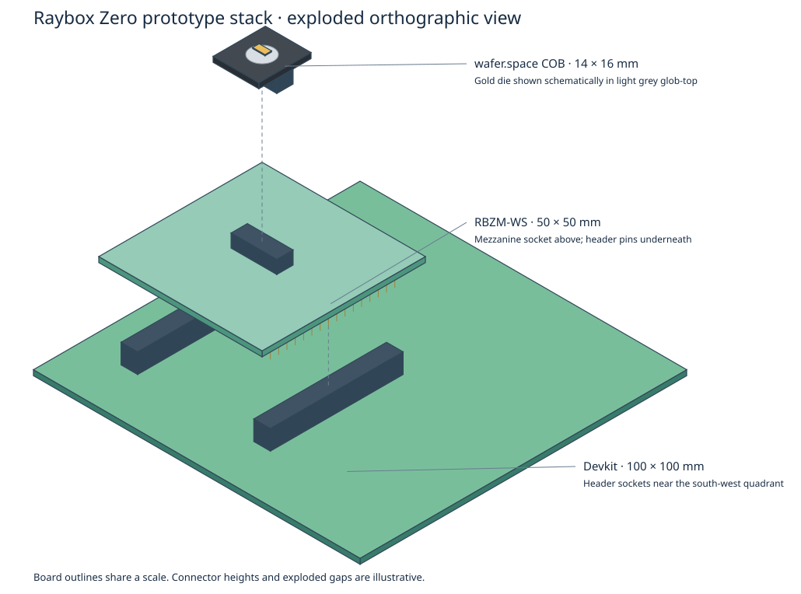
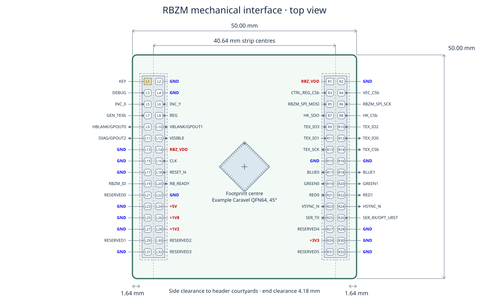
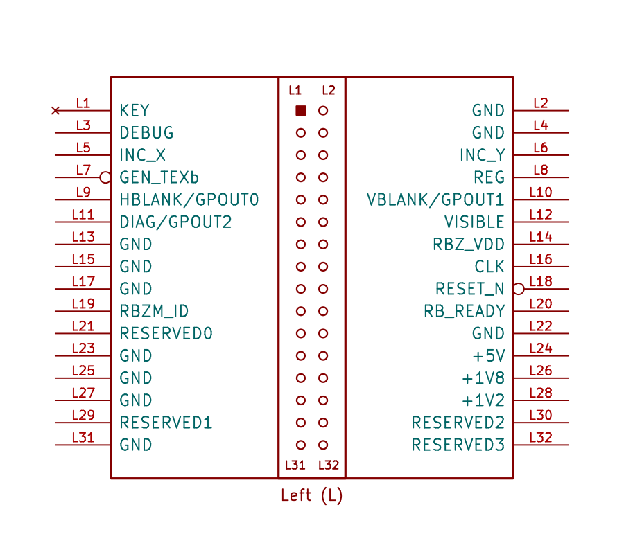
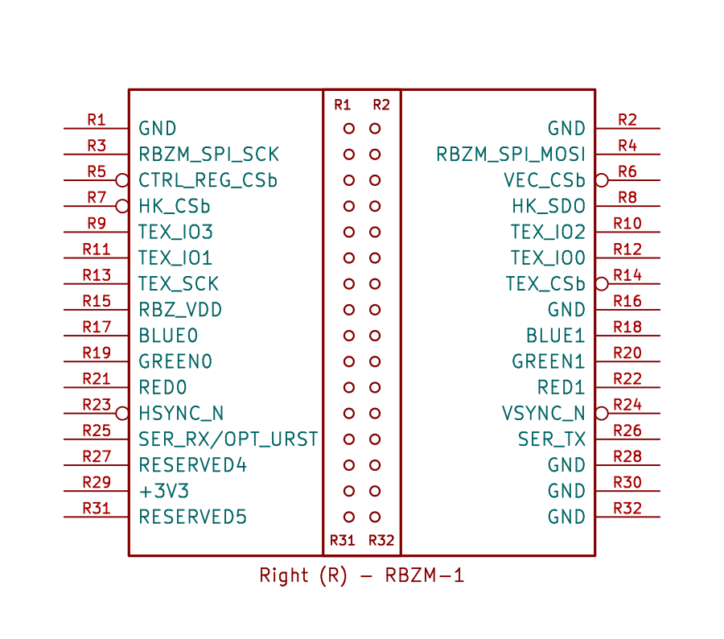

# Raybox Zero Module (RBZM)

Draft for review · 16 November 2026

RBZM is the pluggable interface for the Raybox Zero (RBZ) devkit. It lets one baseboard exercise different RBZ implementations with the same clock, controls, texture flash and video circuitry. Throughout this guide, **WS** means **WS-ASIC**, the dedicated Raybox Zero implementation from the wafer.space Run 2 shuttle. RBZM is a prototyping interface. Every RBZM module, including RBZM-WS, is a prototype. The dedicated WS ASIC itself is the intended production part and can be integrated directly into reduced-BOM production boards.

| Initial configuration | What it contains |
|---|---|
| **RBZM-Caravel** | GFMPW1 QFN64 running Raybox Zero as design 0, its management firmware flash and interface adaptation |
| **RBZM-WS** | Dedicated wafer.space GF180 1×0.5 Raybox Zero ASIC, on a COB carrier or adapted from its mezzanine |
| **Direct GFMPW1** | Optional population of the baseboard QFN and local boot circuitry. Electrically an alternative to an installed module. |

The wafer.space mezzanine and RBZM are separate interfaces. An adapter between them maps signals, supply and mechanics.

## What goes on each board

The 50 × 50 mm RBZM-WS carrier plugs into sockets near the south-west quadrant of the 100 × 100 mm devkit, shifted about 10 mm inward along each board axis. The Run 2 1×0.5 wafer.space COB board measures **14 × 16 mm**, from the PCB’s Edge.Cuts coordinates. It plugs into the carrier’s mezzanine socket with the glob-top die facing up. The gaps and connector shapes are illustrative. [Run 2 board source](https://github.com/wafer-space/chip-on-board-wire-bonded-pcbs/blob/main/run-2/1x0p5-cob/mezzanine-1x0p5.kicad_pcb)

- **Devkit:** Upward-facing sockets, power generation and selection, oscillator, CH32X033 microcontroller (X033 throughout this guide) and USB, control SPI, shared texture flash and its translators/programmer, RGB DAC and VGA, and optional MS9288C HDMI circuitry.
- **RBZM-Caravel:** GFMPW1, local boot flash and its level adaptation, ASIC decoupling, and circuitry that maps module-side controls and defaults to Caravel. Firmware selects design 0 and can assert `RB_READY`.
- **RBZM-WS:** Dedicated ASIC or an adapted wafer.space carrier, local decoupling and WS-specific straps including texture-PMOD type 1. Optional circuitry can generate `VISIBLE` or `RB_READY`.
- **Direct GFMPW1 option:** The baseboard carries the QFN and the equivalent local Caravel circuitry. GFMPW1 is available ahead of the WS ASIC, so this option can get the devkit running sooner. Omit it if RBZM-Caravel can be ready in time. If fitted, use it as an alternative to plugging in a module.

## Physical interface

Arrowheads show signal direction relative to the module. Red labels mark supplies and blue labels mark ground. The passive ID, key and reserved contacts have no arrows. [Original KiCad footprint export](diagrams/footprint.svg)

Two parallel 2×16 through-hole strips on 2.54 mm pitch are separated by **40.64 mm centre-to-centre**. The same spacing applies from L1 to R1. The row-1-to-row-16 span is 38.10 mm. With nominal 5.08 mm-wide strip bodies, the pair occupies 45.72 × 40.64 mm and fits centred within the target 50 × 50 mm module. Verify the actual connector bodies, stack height and underside clearance, particularly over the optional baseboard QFN and passives.

Use sockets on the devkit and downward-facing male headers mounted on the module underside. Arduino-shield-style stackable headers are an option when top-side probe access is useful. Check available mating depth and the height and stability of the resulting stack.

Use the **assembled top view** as the common reference. Row 1 is north, L is west and R is east. Both strips have odd pins in the west column and even pins in the east column. L1 and R1 are at the north-west corners of their respective strips. Check the view and mating orientation when placing an underside connector. L1 has a plated pad and is electrically N/C. Mechanical keying requires the corresponding hardware arrangement, such as an omitted male pin and a blocked socket position.

## Pinout

Directions are from the module’s perspective. Targets describe typical use. Optional outputs may be open if the module variant does not implement them.

### Left (L) bank

| Pin | Name | Direction | Function | Target |
|---|---|---|---|---|
| L1 | `KEY` | NC | Mechanical key position | Both |
| L2 | `GND` | Return | Common ground | Both |
| L3 | `DEBUG` | In | Debug control | Both |
| L4 | `GND` | Return | Common ground | Both |
| L5 | `INC_X` | In | Demo motion on X | Both |
| L6 | `INC_Y` | In | Demo motion on Y | Both |
| L7 | `GEN_TEXb` | In | Generated-texture select, low true | Both |
| L8 | `REG` | In | Registered-output select, high true | Both |
| L9 | `HBLANK/GPOUT0` | Out | Horizontal blanking or diagnostic | Both |
| L10 | `VBLANK/GPOUT1` | Out | Vertical blanking or diagnostic | Both |
| L11 | `DIAG/GPOUT2` | Out | Diagnostic output | Both, optional on WS |
| L12 | `VISIBLE` | Out | Active-video indication | Both, optional |
| L13 | `GND` | Return | Common ground | Both |
| L14 | `RBZ_VDD` | Power in | Selectable ASIC supply | Both |
| L15 | `GND` | Return | Common ground | Both |
| L16 | `CLK` | In | System/pixel reference clock | Both |
| L17 | `GND` | Return | Common ground | Both |
| L18 | `RESET_N` | In | Primary reset, low true | Both |
| L19 | `RBZM_ID` | Sense | Passive module identification | Both |
| L20 | `RB_READY` | Out | Module ready indication | Both, optional on WS |
| L21 | `RESERVED0` | — | Reserved contact | Future |
| L22 | `GND` | Return | Common ground | Both |
| L23 | `GND` | Return | Common ground | Both |
| L24 | `+5V` | Power in | Fixed auxiliary rail | Optional |
| L25 | `GND` | Return | Common ground | Both |
| L26 | `+1V8` | Power in | Fixed auxiliary rail | Future / optional |
| L27 | `GND` | Return | Common ground | Both |
| L28 | `+1V2` | Power in | Fixed auxiliary rail | Future / optional |
| L29 | `RESERVED1` | — | Reserved contact | Future |
| L30 | `RESERVED2` | — | Reserved contact | Future |
| L31 | `GND` | Return | Common ground | Both |
| L32 | `RESERVED3` | — | Reserved contact | Future |

### Right (R) bank

| Pin | Name | Direction | Function | Target |
|---|---|---|---|---|
| R1 | `RBZ_VDD` | Power in | Selectable ASIC supply | Both |
| R2 | `GND` | Return | Common ground | Both |
| R3 | `CTRL_REG_CSb` | In | WS CTRL or Caravel register SPI select | Both |
| R4 | `VEC_CSb` | In | Vector SPI select | Caravel |
| R5 | `RBZM_SPI_MOSI` | In | Shared control SPI data | Both |
| R6 | `RBZM_SPI_SCK` | In | Shared control SPI clock | Both |
| R7 | `HK_SDO` | Out | Dedicated housekeeping SPI return | Caravel |
| R8 | `HK_CSb` | In | Housekeeping SPI select | Caravel |
| R9 | `TEX_IO3` | In | Texture read-data bit 3 | Both¹ |
| R10 | `TEX_IO2` | In | Texture read-data bit 2 | Both |
| R11 | `TEX_IO1` | In | Texture read-data bit 1 | Both |
| R12 | `TEX_IO0` | Bidir | Texture command data and read-data bit 0 | Both |
| R13 | `TEX_SCK` | Out | Texture flash clock | Both |
| R14 | `TEX_CSb` | Out | Texture flash select, low true | Both |
| R15 | `GND` | Return | Common ground | Both |
| R16 | `GND` | Return | Common ground | Both |
| R17 | `BLUE0` | Out | Blue LSB | Both |
| R18 | `BLUE1` | Out | Blue MSB | Both |
| R19 | `GREEN0` | Out | Green LSB | Both |
| R20 | `GREEN1` | Out | Green MSB | Both |
| R21 | `RED0` | Out | Red LSB | Both |
| R22 | `RED1` | Out | Red MSB | Both |
| R23 | `VSYNC_N` | Out | Vertical sync, low true | Both |
| R24 | `HSYNC_N` | Out | Horizontal sync, low true | Both |
| R25 | `SER_TX` | Out | Module UART transmit | Caravel / future |
| R26 | `SER_RX/OPT_URST` | In² | Module UART receive or optional user reset | Caravel / future |
| R27 | `RESERVED4` | — | Reserved contact | Future |
| R28 | `GND` | Return | Common ground | Both |
| R29 | `+3V3` | Power in | Fixed auxiliary rail, e.g. boot flash | Both, as needed |
| R30 | `GND` | Return | Common ground | Both |
| R31 | `RESERVED5` | — | Reserved contact | Future |
| R32 | `GND` | Return | Common ground | Both |

¹ Both pinouts expose IO3. The present Caravel RBZ implementation does not meaningfully consume that bit internally.

² R26 is an input in the intended UART RX and optional-reset modes. On GFMPW1 it is a multiplexed Caravel pad. Treat it as potentially driven during startup or in another pad mode and verify ownership before driving it.

## Signal definitions

**`KEY`**

Electrically N/C. The symbol marks this position with a filled square and the footprint uses reverse-print L1 silkscreen.

Pins: L1.

**`GND`**

Common reference and distributed return contacts. Connect them to ground planes on both boards and preserve the nearby return paths for `CLK`, texture SPI and video.

Pins: L2, L4, L13, L15, L17, L22, L23, L25, L27, L31, R2, R15, R16, R28, R30, R32.

**`RBZ_VDD`**

Two contacts for the same selectable ASIC supply. Nominally 5 V (optional whole-chip 3.3 V operation is an uncharacterized experiment). On GFMPW1 feed the seven named positive domains at the same voltage, with individual links if domain measurements are desired. Provide local decoupling. Keep this net independently selectable from the fixed rails and provide a supply-current measurement point.

Pins: L14, R1.

**`+5V`, `+1V8`, `+1V2`, `+3V3`**

Fixed auxiliary rails from the baseboard, one contact each. They can power suitable glue or flash and support future modules. Leave unused rails open on the module. Keep the fixed rails separate from one another and from the selectable ASIC rail except through the intended baseboard source selection.

Pins: L24, L26, L28, R29.

**`CLK`**

Baseboard clock to the WS clock pad or GFMPW1 system-clock pin. Use a clean LVCMOS clock with adequate high-level margin for the receiving pad and a short return path via L15. A 3.3 V oscillator is the working plan for nominal 5 V GF180 operation. Verify its output swing under load and avoid driving an unpowered module.

Pins: L16.

**`RESET_N`**

Direct active-low reset on WS. On Caravel it asserts package `RESETb`, which resets management. Caravel firmware and mux configuration determine propagation to RBZ, and startup must explicitly establish the user-design reset state. Reset does not make the RBZ texture outputs Hi-Z.

Pins: L18.

**`RBZM_ID`**

Passive baseboard sense input, preferably on an ADC-capable X033 pin. Proposed straps are 47 kΩ down on the baseboard, open for Caravel and 4.7 kΩ up to `+3V3` on WS, yielding about 3.0 V on WS. Open and empty socket give the same reading. Intermediate codes can be reserved for ADC-based identification. Disable MCU internal pulls during measurement.

Pins: L19.

**`RB_READY`**

Indicates readiness for RBZ control, rather than supply presence alone. On Caravel, management firmware can drive the standalone GPIO after pad configuration, design selection and reset initialization. On WS, a module may derive it from reset/clock readiness or leave it open and let the baseboard use a defined startup delay.

Pins: L20.

**`DEBUG`**

WS has one `DEBUG` input. Caravel can fan this line out to `debug_vec`, `debug_map` and `debug_trace`, with separate branch links where independent testing is desired.

Pins: L3.

**`INC_X` and `INC_Y`**

Demo motion controls, mapped to WS `DEC_X` and `DEC_Y` and Caravel `mode0_inc_px` and `mode1_inc_py`.

Pins: L5, L6.

**`GEN_TEXb`**

Following the polarity used by the WS-ASIC, and assuming texture-PMOD type is strapped high (type 1), bringing `GEN_TEXb` low will enable simple on-chip generated textures instead of texture data being used from the Textures QSPI interface (though the interface may continue to drive QSPI reads that are otherwise unused). For RBZM-Caravel, invert `GEN_TEXb` on the module in order to have it drive `mode2_gen_tex` high when generated textures are desired. Set a deterministic startup level before either X033 firmware or Caravel firmware takes control.

Pins: L7.

**`REG`**

When pulled high, `REG` selects registered outputs (instead of direct combinatorial outputs). This follows WS-ASIC polarity, but for Caravel needs inversion into `reg_outs_enb`. Set a deterministic startup level before either X033 firmware or Caravel firmware takes control.

Pins: L8.

**`HBLANK/GPOUT0`, `VBLANK/GPOUT1`, `DIAG/GPOUT2`, and `VISIBLE`**

WS provides fixed `HBLANK` and `VBLANK`. Caravel `GPOUT0` and `GPOUT1` should use selector 0 for the corresponding signals in normal operation. `GPOUT2` can expose another diagnostic, including texture `IO0` output-enable state with selector 12. WS may route a diagnostic such as `VPOS[9]` or leave L11 open. Where fitted, `VISIBLE` is active high and may be derived as NOR(`HBLANK`, `VBLANK`). A [TI SN74LVC1G02](https://www.ti.com/product/SN74LVC1G02) implements this in one gate. Power it from `+3V3` for a 3.3 V output. Its inputs accept up to 5.5 V and require at least 2.0 V for a high at that supply. Add local decoupling and check the receiver's high threshold. Align its latency to RGB and treat it as valid only while L9/L10 carry blanking. `VBLANK` rising can also serve as an X033 frame interrupt.

Pins: L9–L12.

**`RBZM_SPI_SCK`, `RBZM_SPI_MOSI`, `CTRL_REG_CSb`, `VEC_CSb`, `HK_CSb`, and `HK_SDO`**

**Caravel** exposes three SPI slaves. `CTRL_REG_CSb` selects the write-only register slave and `VEC_CSb` selects the write-only vector slave. `HK_CSb` selects the read/write housekeeping slave, which returns data on `HK_SDO`. Housekeeping passthrough can program the local boot flash, which is separate from texture storage.

**WS** exposes one write-only, command-driven CTRL slave on `CTRL_REG_CSb`. Leave `VEC_CSb`, `HK_CSb` and `HK_SDO` open on the WS module. Its payload format differs from Caravel’s.

`RBZM_SPI_MOSI` and `RBZM_SPI_SCK` fan out to the populated slaves on the module. Keep all chip selects inactive at startup and assert only the select for the intended slave.

Pins: R3–R8.

**`TEX_SCK`, `TEX_CSb`, and `TEX_IO0`–`TEX_IO3`**

`TEX_SCK` and active-low `TEX_CSb` are driven by RBZ. `TEX_IO0` carries command/address bits from RBZ and reverses direction for quad data return. `TEX_IO1`, `TEX_IO2` and `TEX_IO3` carry read data from flash toward the module. The proposed baseboard uses a TXB0104 level translator on `TEX_SCK`, `TEX_CSb` and `TEX_IO0`, with its module-side supply tracking `RBZ_VDD`. The other three lanes may connect directly if pad thresholds, boot-time pin directions and power sequencing permit. Measure `TEX_IO0` turnaround and skew against the direct lanes. See [Texture flash programming](#texture-flash-programming) for the baseboard handoff.

Pins: R9–R14.

**RGB222, `VSYNC_N`, and `HSYNC_N`**

`BLUE0`/`BLUE1`, `GREEN0`/`GREEN1` and `RED0`/`RED1` are each ordered LSB/MSB. Caravel packs them as `BBGGRR`, with red in bits 1:0. `VSYNC_N` and `HSYNC_N` are active-low vertical and horizontal sync. On the devkit, follow Leo Moser’s [Tiny VGA RGB222 DAC](https://github.com/mole99/tiny-vga) architecture. Run all eight signals through a 5.5 V-input-tolerant [SN74LVC245A](https://www.ti.com/lit/ds/symlink/sn74lvc245a.pdf) powered from fixed `+3V3`, with its direction set from RBZ toward video. This buffers and down-shifts the six colour bits and both syncs in one part. Choose the DAC resistors for a 3.3 V digital swing and about 0.7 V full scale into one 75 Ω termination per colour. While `+3V3` remains fixed and the RBZ outputs meet the buffer’s input thresholds, changing `RBZ_VDD` from 5 V to 3.3 V does not rescale the DAC output.

Route the same buffered 3.3 V `HSYNC_N` and `VSYNC_N` to VGA and the optional MS9288C sync inputs. This avoids assuming that an external VGA-to-HDMI adapter tolerates 5 V sync. Check the buffered high level at the VGA connector under cable and receiver load. The optional MS9288C analogue branch uses three jumpers upstream of its RGB termination and coupling circuitry. Open them for VGA and close them for HDMI conversion with the VGA monitor disconnected, so there is one termination per colour.

Pins: R17–R24.

**`SER_TX` and `SER_RX/OPT_URST`**

UART directions are relative to the module. On Caravel, `SER_TX` is management TX and `SER_RX/OPT_URST` can be RX or the optional active-high user-design reset if firmware has configured the pad and mux accordingly. Optional user reset is not the power-on reset route. Confirm the boot-time pad state before the X033 drives `SER_RX/OPT_URST`. WS can leave both open and future modules can implement UART here.

Pins: R25, R26.

**`RESERVED0`–`RESERVED5`**

Leave electrically unassigned on interoperable modules. Any revision that assigns them should define the voltage, direction and startup state.

Pins: L21, L29, L30, L32, R27, R31.

## Texture flash programming

This is a proposed devkit circuit and firmware sequence. The module interface supplies the texture bus. The devkit implements ownership switching. Here, the programmer is the CH32X033 and its flash-side drive circuit.

1. **Disconnect RBZ.** Drive the TXB0104 level translator’s active-high `OE` low and wait for the specified output-disable interval. RBZ reset alone does not release the bus.
2. **Take ownership in standard single-bit SPI.** Preload the MCU-side outputs with flash chip select high and clock idle, then enable their flash-side drivers. A 5 V X033 needs 3.3 V tri-state buffering for chip select, clock and MOSI. Use flash `IO0` as MOSI and `IO1` as MISO for status and readback. Single-bit SPI simplifies programming because the MCU does not need quad data direction switching.
3. **Keep the flash deselected during the gap.** A resistor from flash-side chip select to `+3V3` keeps it high while the TXB0104 and MCU drivers are both high impedance. TI recommends external pulls greater than 50 kΩ on TXB0104 signal lines. Start with 100 kΩ and verify the rise time and leakage margin. This pull is on the signal line and is distinct from the translator’s `OE` bias. [TXB0104 datasheet](https://www.ti.com/lit/ds/symlink/txb0104.pdf)
4. **Hand back.** Wait for flash busy to clear, verify data, and preserve or restore Quad Enable as required for normal RBZ reads. Deselect the flash, release the MCU drivers, and re-enable the TXB0104 at a clean transaction boundary. Keep the ASIC powered unless direct return lanes have been checked for back-powering, and verify they stay inputs in all relevant Caravel pad states.

## Pulls, straps and isolation

A pull defines the logic level a receiver sees when no active driver sets it. Put the pull on the board that contains the receiver if that receiver must read a valid idle state with its mate absent, unpowered or isolated. For example, a devkit pull-down on `RB_READY` covers an empty socket. A module-local pull is intentional for ASIC-only straps or to keep module inputs safe when the module is used on another carrier. Use both only if each side needs a defined state while disconnected or isolated. When connected, check the combined pull strength and polarity. Reference each pull to a compatible domain and check partial-power current.

| Signals | Devkit | Module |
|---|---|---|
| `RB_READY`, optional blanking/diagnostics, `VISIBLE` | Pull down `RB_READY` to give a defined not-ready state. For other signals, fit a safe idle bias at the receiver only if used, especially on interrupt inputs. | Drive the signal if implemented. Otherwise leave it open. |
| `HK_SDO`, `SER_TX` | Bias UART RX high if monitored with no driver. Bias housekeeping return only if sampled while undriven. | Leave optional outputs open when unused. |
| `CTRL_REG_CSb`, `VEC_CSb`, `HK_CSb` | Provide inactive-high defaults through MCU reset. Reference pulls to the receiving domain or isolate the drivers and pulls while that domain is off. | Add local inactive-high pulls for independently used or isolated slave inputs where needed. |
| `DEBUG`, `INC_X`, `INC_Y`, `GEN_TEXb`, `REG` | Define your startup mode. Typically idle debug and motion low, choose generated versus external texture deliberately, and use a reset supervisor or equivalent if a timed reset is required. | Strap ASIC-only modes locally and bias any inputs created by local inversion or isolation. Set the downstream defaults for the actual ASIC polarity. |
| `RESET_N` | Provide an inactive-high pull referenced to the module’s reset domain where suitable for the selected source. Use a jumper to select RC power-on reset, a supervisor output for testing, or an X033 GPIO. Design for clean edges and predictable behaviour while the MCU boots. | Keep any separate module-local reset defined while isolated. Verify module input threshold and reset pulse width. |
| `RBZM_ID` | Proposed 47 kΩ pull-down and ADC sense. | Caravel open. WS proposed 4.7 kΩ to `+3V3`. |
| `SER_RX/OPT_URST` | Use high impedance until the module's startup pad function is known. UART idle-high and active-high reset idle-low require different treatment. | Set the mode-specific idle state locally if needed and verify pad ownership before applying a pull or drive. |
| Flash bus | Pull flash-side chip select high through ownership gaps. With TXB0104, use a pull compatible with the translator's weak drive. Check flash requirements for IO2/IO3 as WP/HOLD/RESET. Give both translator and programmer enables safe reset defaults. | Use local flash pulls and isolation for the separate Caravel boot flash. |

Also account for series damping at clock sources, translator output-enable bias, optional isolation or test links, rail sequencing, decoupling and the DAC termination. Check both directions of every voltage crossing, including MCU and bridge inputs. Bias at the local receiving rail or use partial-power-down isolation where a fixed-rail pull would back-power another device.

## PCB layout checklist

- [ ] Use devkit sockets and downward-facing module pins. Confirm keying, pin-number alignment on both mating views, connector spacing and vertical clearance.
- [ ] Keep the module footprint area clear on the devkit where practical. Reserve the space under the module for the optional direct GFMPW1 circuit and its local parts. Put the shared texture flash, level converters and their test pads outside the module outline so they can be probed in operation.
- [ ] Provide a mutually exclusive `RESET_N` source selector for RC or supervisor experiments and X033 GPIO control. Plan for MCU control in normal use. If using RC, verify the edge rate at the ASIC and buffer with a Schmitt gate if needed. Define the GPIO’s reset-time state in hardware.
- [ ] Put accessible probe points on clock, reset, ID/ready, control SPI, translator enables and both sides of the texture translation. Include nearby ground points and access to analogue RGB.
- [ ] Place the 3.3 V video buffer and its decoupling close to the DAC. Fix the direction toward video and give output enable a defined startup state. Route the buffered syncs to both VGA and MS9288C, and verify RGB full scale into one 75 Ω load per colour.
- [ ] Route clock, texture and video over continuous returns. Keep the texture translator close to the flash, and keep RGB DAC and termination branch stubs short.
- [ ] Provide rail-selection/current-measurement links and a way to isolate the direct GFMPW1 supply and signal branches. Keep its boot flash and decoupling close to the QFN.
- [ ] Check GPIO and pull states during startup, programming takeover, and partial power. Confirm that the intended probe points remain accessible with a module installed.

## Baseboard integration and bring-up

- Keep the direct GFMPW1 footprint and the plug-in module mutually exclusive. Put removable links at the QFN fanout so the shared ECO/debug nodes and module socket remain usable after isolating the onboard chip. Isolate its supply and all paths that could drive, contend or back-power it.
- A diagonal QFN placement is a routing candidate. In the previously discussed footprint orientation, the two sides covering QFN 1–32 face toward the left strip and 33–64 toward the right. Verify with actual pad positions in the PCB editor. Prioritize short, well-referenced clock, texture and video routes. Shared control SPI and the Caravel-only Chip Selects can tolerate longer routes at their intended rates.
- Keep the Caravel management flash and its level adaptation local to the QFN. Leave legacy IO0/JTAG, IRQ and other variant-specific diagnostics as local test access where needed. The texture programmer and VGA/HDMI selection reside on the baseboard.
- Check rail current, ID and reset first. For Caravel, confirm boot, pad transfer, design 0 selection and readiness before sending RBZ transactions. Verify VGA timing and blanking, then test normal texture reads and the SPI ownership transfer in both directions, including X033 reset during programming.
- Keep the production paths separable. The intended WS-only variants are standalone USB power + VGA, USB CDC/X033 + texture flash + VGA, and an extended version with selectable VGA or MS9288C HDMI output. Caravel recovery and RBZM hardware are prototype features.

## KiCad and related sources

The two-unit symbol is `RBZM_Raybox_Zero_Module` in `RBZM.kicad_sym`. Units A and B share one reference and one footprint. The assigned footprint is `Anton:RBZM_Raybox_Zero_Module` in `Anton.pretty`. The KiCad package includes `generate_rbzm.py` for regenerating both. The SVGs were exported with `kicad-cli sym export svg` (one per unit) and `kicad-cli fp export svg` (the footprint). The dimensioned physical view uses the generated KiCad geometry and pin names, with an illustrative QFN placement. The exploded view is a separate orthographic drawing. The KiCad exports retain their original viewBox and use a 900 px intrinsic width with proportional height. Markdown viewers can still scale them to fit the available column. Open the SVG directly for zoomable detail.

- [RBZM KiCad package](https://chatgpt.com/library?file_id=libfile_d3df78dd84ec8191b1916ec897b212e3&account_id=personal)
- [Detailed WS vs Caravel pin comparison](https://chatgpt.com/library?file_id=libfile_5bbe4c5b75988191a9923a6ad7d5eb07&account_id=personal)
- [Dedicated WS ASIC project](https://github.com/algofoogle/gf180ws2-raybox-zero)
- [GFMPW1 design mux](https://github.com/algofoogle/algofoogle-multi-caravel/blob/9871f786967d514317c7a2e1e2b2107cce685c2d/verilog/rtl/mux/top_design_mux.v)
